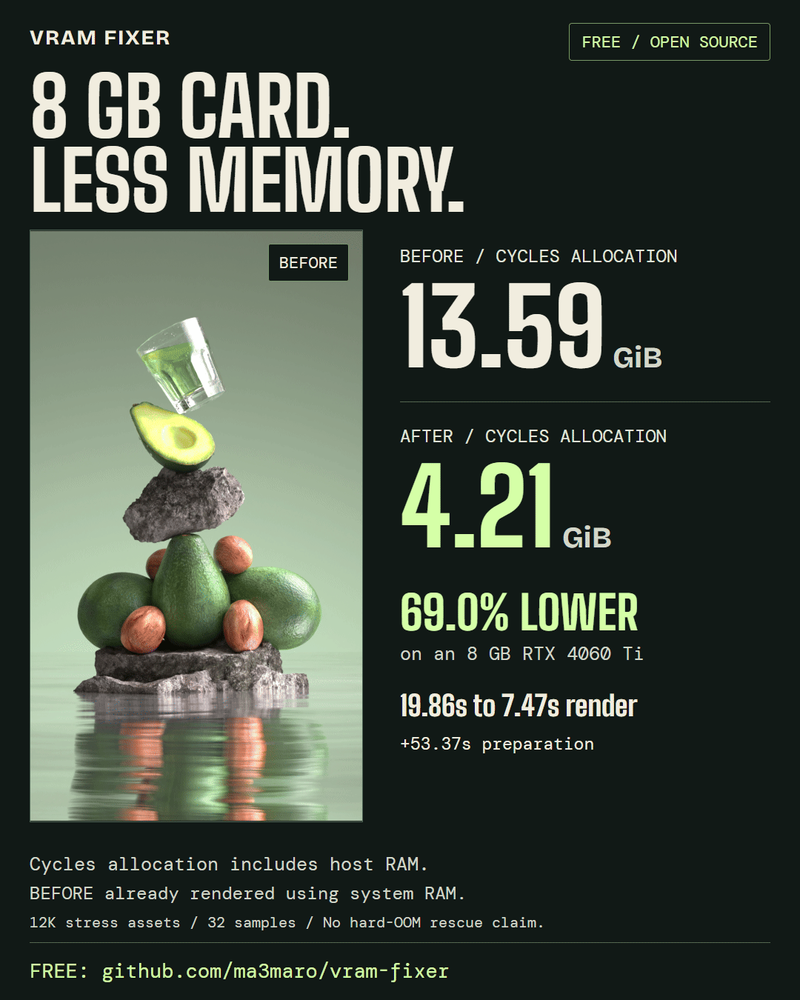
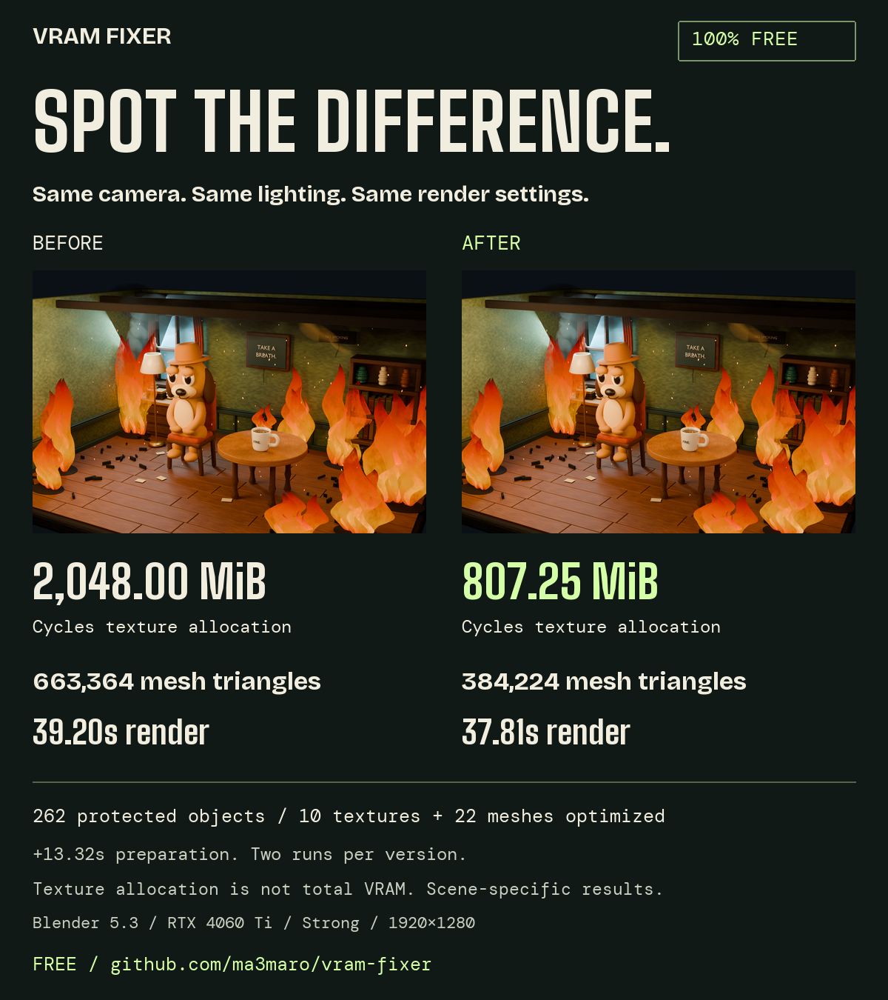

# VRAM Fixer

## Keep the shot. Cut the waste.

**A free Blender 5.3 add-on for Cycles scenes that put pressure on GPU memory.** Choose a size reference, protect the important objects, and reduce oversized textures and small, dense meshes. Restore the originals when you need them.

**[Download the add-on](https://github.com/ma3maro/vram-fixer/releases/latest/download/vram_fixer-1.1.0.zip)** · **[Free Reddit media kit](https://github.com/ma3maro/vram-fixer/releases/latest/download/reddit-media-kit.zip)** · [How the tests were measured](benchmarks/README.md)

Upload note: the add-on and media kit are live. The large packed `.blend` and 16-bit-render archives timed out and are **not attached**. Original demo generators are included below; the author still has the packed files locally.

No account, API key or cloud service. GPL-3.0-or-later.


### When the scene outgrows the card

An 8 GB GPU does not stop a scene from asking for more memory. Cycles may spill allocations into system RAM. The add-on reduces what the scene asks for; it does not create extra VRAM.

In our deliberately oversized **12K texture pressure test**, an RTX 4060 Ti 8GB rendered this before/after:



| Pressure test | Before | After |
|---|---:|---:|
| Cycles-reported peak allocation, including host RAM | 13.59 GiB | 4.21 GiB |
| Render call | 19.86s | 7.47s |
| Additional analysis/application | — | 53.37s |

**The before scene already rendered using system RAM. This is not a failed-render rescue demonstration.** At 16K, both the render and the add-on's processing hit our host-RAM safety guard. OOM recovery is not guaranteed. [Raw figures and limitations](benchmarks/README.md).

### Same burning room. Less overhead.

The original 3D demo has 656 objects, sculpted fire, volume smoke, a sleepy dog and deliberately oversized source bakes. Its generators are included.



| Burning-room demo | Before | After | Reduction |
|---|---:|---:|---:|
| Cycles texture allocation | 2048.00 MiB | 807.25 MiB | **60.6%** |
| Evaluated mesh triangles, curves/text excluded | 663,364 | 384,224 | **42.1%** |
| Cycles-reported peak allocation | 2712.94 MiB | 1455.91 MiB | **46.3%** |
| Render call, mean of two runs | 39.20s | 37.81s | 3.5% |

Core preparation took **13.32s**, separately from rendering. This is primarily a memory-reduction tool, not a universal render-speed booster. Cycles allocation is not the same as total dedicated VRAM. Both tests used controlled, intentionally oversized assets; results vary.

## Use it

1. **Install:** download `vram_fixer-1.1.0.zip`. In Blender, use **Edit → Preferences → Add-ons → Install from Disk**. Enable VRAM Fixer.
2. **Open:** 3D View → **N → VRAM Fixer**.
3. **Reference:** select a medium-sized or focal mesh, then **Use Active Object as Reference**. It defines camera-space importance and is protected by default.
4. **Exclude:** select objects that must not change, then **Add Selected** under Never Touch.
5. **Choose:** Textures, Meshes, or both. Start with **Careful**; use **Analyze** to see the plan.
6. **Apply:** press **Fix VRAM**, then compare a render.
7. **Restore:** reconnect original images and remove owned Decimate modifiers with **Restore Originals**. Restore before changing camera, frame or resolution and optimizing again.

## What it actually does

- Camera-space size and UV-density analysis, rather than one texture cap for the whole scene.
- Image discovery through ramps, mixes and nested shader groups, with instance-specific UV routing.
- Packed, reduced texture copies. Original source image files are not overwritten.
- Non-applied Decimate modifiers with sampled geometric-error checks and automatic backoff.
- Protected shared resources, per-asset skip reasons and persistent Restore records after reopening.

[Technical notes](docs/technical-notes.md) · [Known limitations](docs/limitations.md) · [Report a problem](https://github.com/ma3maro/vram-fixer/issues/new)

## Files and reproduction

- `vram_fixer/`: add-on source. Install the release ZIP, not GitHub's source-code ZIP.
- `tests/`: policy and actual-Blender regression tests.
- `demo/`: reproducible original scene/texture generators. The large packed scene/render uploads did not finish; those files are not currently in Releases.
- `benchmarks/`: measured results, definitions and native log excerpts.
- `media/`, `marketing/`: ready-to-post comparisons, GIFs, MP4s and Reddit drafts.
- `promo/`, `promo-pressure/`: editable local HTML animation projects.

```bash
python -m unittest discover -s tests -v
# Blender integration checks; use your Blender executable:
blender -b --factory-startup --python-exit-code 1 --python tests/blender_integration.py
blender -b --factory-startup --python-exit-code 1 --python tests/blender_safety.py
blender -b --factory-startup --python-exit-code 1 --python tests/blender_regressions.py
```

The original avocado source scene and third-party material libraries are not redistributed. Its final comparison renders and numerical evidence are included. The burning-room geometry and bakes were authored for this demo; no comic image is embedded. [Asset and dependency notes](docs/credits.md).
