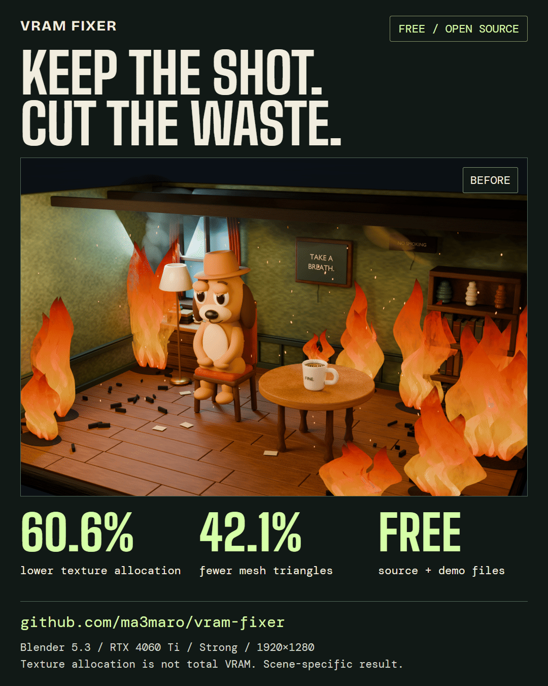

# VRAM Fixer

## Keep the shot. Cut the waste.

**Free, open-source optimization for Blender / Cycles.** Pick a size reference, protect the important objects, and reduce oversized textures and small, dense meshes without overwriting the originals.

### [Download VRAM Fixer](https://github.com/ma3maro/vram-fixer/releases/latest/download/vram_fixer-1.1.1.zip)

No signup. No API keys. No cloud service.

**Compatibility:** the 5.3-only gate is removed. The installer permits Blender **4.2 and later**, the minimum for Blender's extension format. Runtime checks passed on **5.0.1, 5.1.2 and 5.3.0**; 4.x is not runtime-tested here. Version numbers in the benchmark media describe the test setup, not an exclusive requirement.

## Same scene. Less overhead.

The burning-room demo used the same camera, lighting, exposure and render settings before and after optimization.

| Measurement | Before | After | Reduction |
|---|---:|---:|---:|
| Cycles texture allocation | 2048.00 MiB | 807.25 MiB | **60.6%** |
| Evaluated mesh triangles | 663,364 | 384,224 | **42.1%** |
| Cycles-reported peak allocation | 2712.94 MiB | 1455.91 MiB | **46.3%** |
| Render time, two-run average | 39.20s | 37.81s | 3.5% |

**10 textures and 22 meshes optimized. 262 protected objects unchanged.**

Preparation took another **13.32s**. This is a memory-reduction tool, not a promise of faster rendering. Texture allocation is not total dedicated VRAM; mesh counts exclude curves and text.

## When the scene outgrows the card

An oversized texture test on an **8 GB RTX 4060 Ti** reduced Cycles-reported allocation from **13.59 GiB to 4.21 GiB**.

| 12K texture pressure test | Before | After |
|---|---:|---:|
| Cycles allocation, including host RAM | 13.59 GiB | 4.21 GiB |
| Render call | 19.86s | 7.47s |
| Additional preparation | — | 53.37s |

The before scene already rendered using system RAM. These are not physical per-process VRAM readings or proof of a failed-render rescue. The larger 16K test hit a system-RAM safety limit in both paths. Results are specific to these controlled, deliberately oversized demo assets.

## Install and use

1. **Download** `vram_fixer-1.1.1.zip` using the link above. GitHub's source-code ZIP is not the installer.
2. In Blender, choose **Preferences → Add-ons → Install from Disk** and enable VRAM Fixer.
3. Open **3D View → N → VRAM Fixer**.
4. Select a medium-sized or focal mesh, then **Use Active Object as Reference**. It is protected by default.
5. Add anything that must stay untouched to **Never Touch**.
6. Choose **Textures**, **Meshes**, or both. Start with **Careful**, inspect **Analyze**, then press **Fix VRAM**.
7. Use **Restore Originals** when needed, including after saving and reopening.

## What it handles

- Camera-space size and UV-density budgets instead of one texture cap for the entire scene.
- Textures behind ramps, mixes and nested shader groups.
- Non-applied Decimate modifiers with sampled geometric checks and automatic backoff.
- Protected shared resources, per-asset skip reasons and persistent Restore records.

Keep a backup and compare a render. Optimization is camera/frame-specific and can require extra system RAM. Restore before changing camera, frame or resolution. Faster renders, zero visual loss and OOM recovery are not guaranteed.

## Media

[Burning-room video](media/room-comparison.mp4) · [8 GB pressure-test video](media/pressure-comparison.mp4) · [Launch image](media/01-launch.png) · [Pressure-test image](media/03-8gb-pressure-test.png)

The `media` folder contains the rendered comparisons and promo images. The 3D demo scene files are not bundled in this repository.

Free under [GPL-3.0-or-later](vram_fixer/LICENSE).
